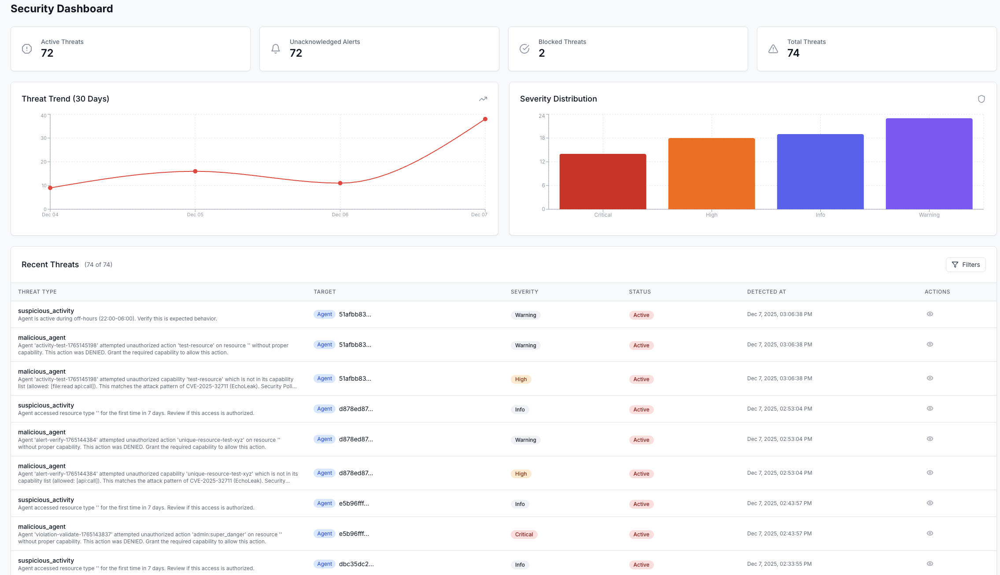
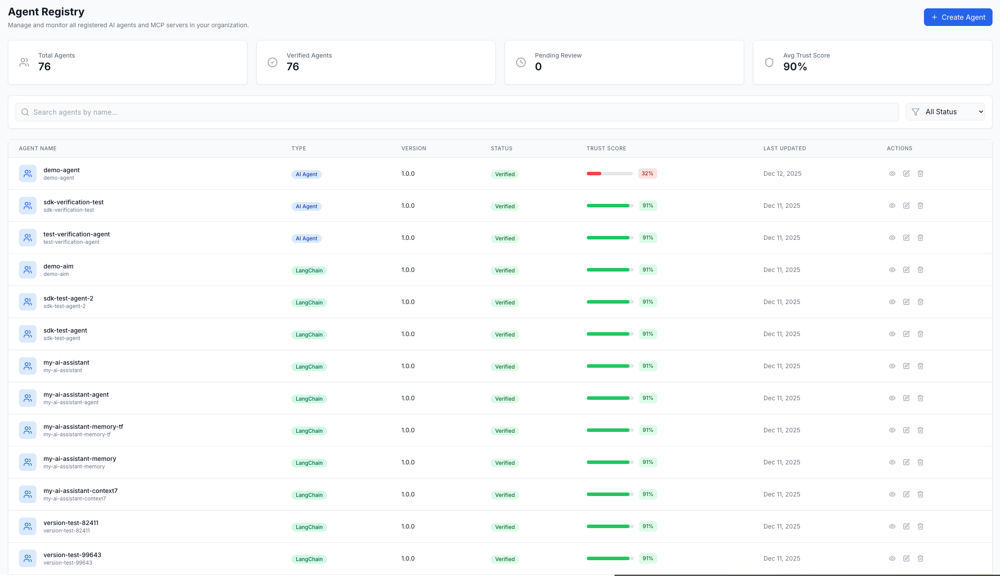
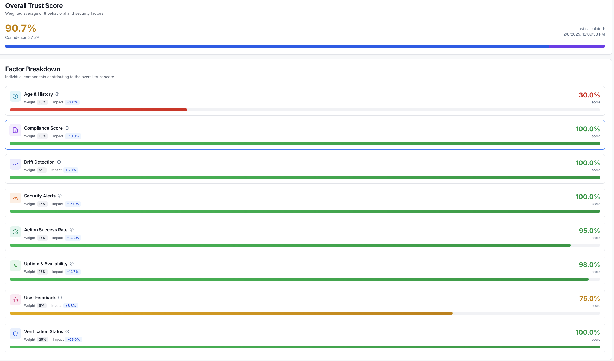
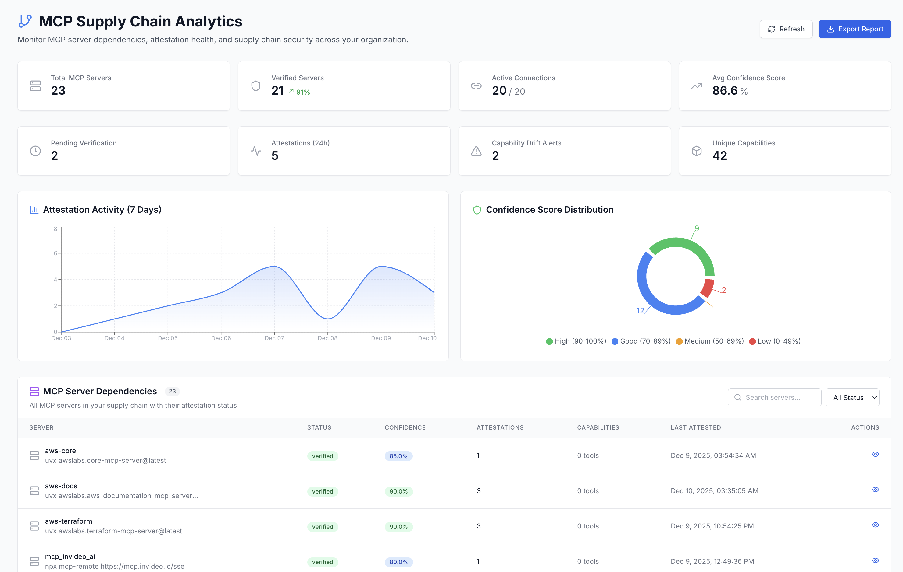

# AIM server features

What the AIM server adds over the SDKs' local checks: the authorization engine, the trust score, attestation of MCP servers, privileged access management, security event forwarding to Splunk and Microsoft Sentinel, agent credentials read from a CyberArk vault, and the web dashboard. Available in the self-hosted and AIM Cloud deployment modes, except SIEM forwarding and the CyberArk secrets backend, which run in self-hosted deployments only.

## 5-step Fine-Grained Authorization

`POST /api/v1/agents/:id/authorize` runs an agent's request for a capability through the checks below, in order, and stops at the first one that denies. When the agent has no FGA policy for that capability, it runs step 1 only.

| Step | Check | Latency budget |
|---|---|---|
| 1 | Capability | <10ms |
| 2 | Attribute | <10ms |
| 3 | Context | <10ms |
| 4 | Chain | <10ms |
| 5 | Intent (NanoMind) | not on the decision path |

Step 5 runs only when the policy's risk level is HIGH or MEDIUM; it is skipped for LOW. It hands the request to a NanoMind daemon (`FGA_DAEMON_URL`, default `http://127.0.0.1:47200`) without holding the decision, records the daemon's classification, and never denies. Neither compose file in this repository starts that daemon.

The SDKs do not call this route. `@perform_action` (Python) and `performAction()` (Java) post each call to `/api/v1/sdk-api/verifications`, where the server decides with the capabilities granted to the agent, the minimum trust score of each capability's definition, the organization's enforcement mode and its security policies. That route records an `fga.authorize` span for its decision with one child, `fga.capability_check`. Routing SDK verifications through this engine is tracked for a fix.

## Trust-gated capabilities

The 9-factor trust score is calculated when an agent registers. It is recalculated when a manager verifies, suspends or reactivates the agent, grants or revokes one of its capabilities, or calls `POST /api/v1/agents/:id/trust-score/recalculate`. The trust re-evaluation job also recalculates the score of every agent that is not revoked, every hour by default (`TRUST_REEVALUATION_INTERVAL`, at least five minutes), and records a score only when it moved since the last one on record.

A verification request (`POST /api/v1/verifications`) does not recalculate the score. From an SDK the same request goes to `POST /api/v1/sdk-api/verifications`; the two routes share a handler. A request for a capability the agent was granted leaves the score unchanged. When a verified agent that holds at least one granted capability, and is not marked compromised, requests a capability outside its grants, the score drops by a fixed 0.10 if the request is blocked and 0.05 if it is let through, never below 0.

Each capability definition carries a minimum trust score: 0%, 30%, 50% and 70% for low-, medium-, high- and critical-risk capabilities. In strict enforcement mode a verification request for a granted capability is denied when the agent's trust score is below that minimum; in monitoring mode it is allowed. No route changes a minimum.

On a strict-mode organization, a score below the threshold of an enabled `trust_score_low` security policy can block a verification request for a granted capability; the policy's enforcement action decides whether it blocks or only raises an alert.

## MCP attestation

Multi-agent consensus. 3+ attesters across 2+ owners, each connecting and reporting the same tool set, equals verified. A server verified this way returns to pending when its attesters stop agreeing.

## Privileged Access Management

Three tiers: STANDARD, PRIVILEGED, SUPER_PRIVILEGED. Human approval gates, break-glass override, and certification campaigns.

## CyberArk integration

A self-hosted server reads agent credentials from a CyberArk vault through the Central Credential Provider (CCP). With `CYBERARK_CCP_URL`, `CYBERARK_CCP_APP_ID` and `CYBERARK_CCP_SAFE` set, a secrets namespace created with `"backendType": "cyberark_ccp"` is held by the account named `aim-secrets-<namespace id>` in that safe: `POST /api/v1/secrets/resolve` reads the account through CCP for the agent that owns the namespace and answers with its content encrypted to the agent's key. The credential is stored and rotated in CyberArk; a store or a rotation through AIM is answered `409`. See [CyberArk Central Credential Provider](DEPLOYMENT.md#cyberark-central-credential-provider).

Sending session events to Privileged Session Manager (PSM) is under evaluation: no CyberArk interface that accepts them has been identified.

## SIEM adapters

Splunk HEC. Set `SIEM_SPLUNK_HEC_URL` and `SIEM_SPLUNK_HEC_TOKEN` and every audit log entry the server writes is forwarded: buffered batch delivery, retry, severity filtering. Microsoft Sentinel: set the six required `SIEM_SENTINEL_*` variables and the same events reach a Log Analytics table through the Azure Monitor Logs Ingestion API, with the client credentials of a Microsoft Entra application. The server does not use the HTTP Data Collector API, for which Microsoft ended support on 14 September 2026. See [SIEM Forwarding](DEPLOYMENT.md#siem-forwarding).

## Web dashboard

Available in Self-hosted and AIM Cloud modes.

*Fleet overview: agents monitored, actions blocked, and risk by category.*

*Agent registry with trust scores and verification status per agent.*

*Per-agent 9-factor trust score breakdown with weighted signal contributions.*

*MCP server dependencies with multi-agent attestation status.*

## Trust scoring

The local and server trust scores measure different things.

**Local (8 factors)** answers "is the agent's security posture set up correctly?" Computed from local files. Source: [`packages/aim-core/src/trust.ts`](https://github.com/opena2a-org/opena2a/blob/main/packages/aim-core/src/trust.ts).

| Factor | Weight | Signal |
|---|---|---|
| Identity | 20% | `identity.json` exists |
| Capabilities | 15% | `policy.yaml` exists |
| Audit log | 10% | `audit.jsonl` exists |
| Secrets managed | 15% | Secretless integration active |
| Config signed | 10% | ConfigGuard signatures present |
| Skills verified | 10% | HMA verification on skills |
| Network controlled | 10% | Egress policy detected |
| Heartbeat monitored | 10% | ARP runtime heartbeat present |

**Server (9 factors)** answers "is the agent behaving in a way that should still be trusted right now?" Recalculated on the events listed under [Trust-gated capabilities](#trust-gated-capabilities), not on each verification request. Source: [`apps/backend/internal/domain/trust_score.go`](../apps/backend/internal/domain/trust_score.go).

| Factor | Weight | Source |
|---|---|---|
| Verification status | 25% | Externally attested |
| Uptime | 15% | Observed |
| Action success rate | 15% | Observed |
| Security alerts | 15% | Observed |
| Compliance | 10% | Externally attested |
| Execution isolation | 10% | Externally attested |
| Agent age | 5% | Server-recorded |
| Drift detection | 3% | Observed |
| User feedback | 2% | Human input |
